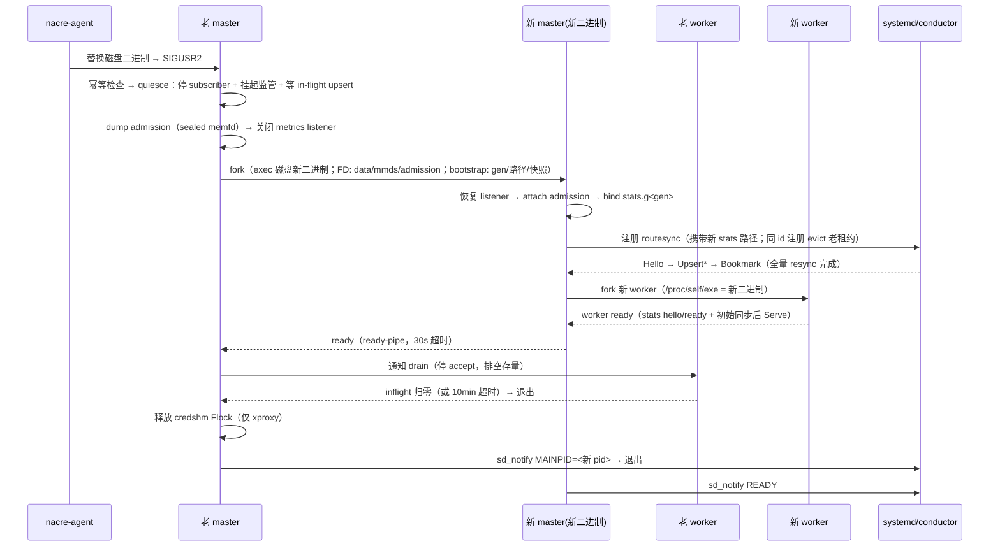

# proxy 热升级方案

> **变更编号**: FE2026050900370-BMS节点组件热升级
> **评审结论**: conductor 不做热升级（冷重启 + nacre-agent 重试兜底），**proxy 做热升级**
> **文档版本**: V2.0（V1.4 原始设计经三轮代码评审 [V1.5/V1.6/V1.7] 后合并重写；评审共发现 12 个问题、7 个阻塞级，已全部并入正文，问题清单见附录 A）
> **代码基线**: orchestrator main `40c7af9`
> **关联文档**: `conductor-no-hotupgrade-with-nacre-retry.md`（conductor 冷重启方案）、`US2026050900110`（官方 node-proxy/sandbox-proxy 平滑升级设计）、`proxy热升级评审问题与解决方案.md`（评审问题详情，用于 issue 回复）

---

## 1. 方案概述

### 1.1 目标

`node-proxy.service`（node-ctl proxy，数据面 master + worker）在二进制替换时实现热升级：

- 存量沙箱的 WebSocket/exec 长连接**尽力排水不中断**（上限默认 10min，可配置；超时 force kill 是兜底而非常态）；
- 新连接正常接入，升级期间服务无空窗；
- 路由与凭证状态无损迁移。

核心语义（与官方 US2026050900110 对齐）："**连接不断、状态不丢**"。注意"零中断"的准确表述是**存量连接尽力排水、上限可配置**——这是验收口径。

### 1.2 技术路线（最终版）

```
SIGUSR2 → 幂等检查 → quiesce（停 routesync subscriber + 挂起 worker 监管 + 等 in-flight upsert 应用完）
  → dump admission 内存状态（sealed memfd，不落盘）→ 老 master 关闭 metrics listener
  → fork 新 master（exec 磁盘上的新二进制——绝不用 /proc/self/exe；
      ExtraFiles: dataListener/mmdsListener/admission memfd FD；
      bootstrap: gen、路径覆盖、admission 快照 + ready-pipe）
  → 新 master：恢复 listener → attach admission + 恢复内存态 → bind StatsSocket.g<gen>
      → 注册 routesync → 收到 Bookmark（全量 resync，含 MMDS 投影）
      → fork 新 worker → worker ready → 新 master 发 ready
  → 老 master 通知老 worker drain（停 accept，排空存量连接）
  → 老 worker 退出 → 老 master 释放 credshm Flock（仅 xproxy）→ sd_notify MAINPID → 退出
```

### 1.3 热升级 vs 冷启动

| 维度 | 冷启动（现状，实测） | 热升级（目标） |
|------|--------------------|--------------|
| 存量长连接 | **全部断开**（master 退出带走 worker，0-2ms 内 EOF） | **尽力排水不中断**（老 worker 继续服务，上限 10min 可配置） |
| 服务空窗 | 端口 refused ~25ms，恢复 ~50ms | 无（listener FD 共享 + ready-pipe 交接） |
| 路由表 | 从 conductor 全量 resync | 同样从 conductor 全量 resync（**唯一来源，无快照**，见 §3.6） |
| admission 限额状态 | 重建 | memfd FD 继承 + quiesce 后 dump/restore（slot 连续） |
| 凭证表（xproxy） | 清空重建 + nacre-agent 重推（502 窗口） | 快照恢复 + generation 继承（无窗口） |

---

## 2. 进程模型与资源交接

### 2.1 进程模型（代码事实）

- **master**（`node-ctl proxy serve`）：持有 dataListener（TCP）/ mmdsListener（netns TCP）/ statsSocket（UDS）/ metricsListener；是 routesync 订阅者、路由表写者、**admission slot 分配者**（`ApplyUpsert` 内 `PrepareUpsert`）、worker 监管者。
- **worker**（`/proc/self/exe` reexec 子进程）：经 FD + sealed memfd bootstrap 继承 listener，accept 连接并双向 relay 到 sandbox 后端；**长连接终点在 worker**（客户端 FD + 后端 FD + relay goroutine）。
- `RunMaster` 为阻塞函数，subscriber/superviseWorker/statsServer/RunGC/per-worker mmdsrpc 封装于 `masterGroup` 内。

### 2.2 资源交接策略（分代模型）

冷启动 gen=0，磁盘资源沿用原路径（不启用热升级的系统零感知）；每次热升级 gen+1，受影响资源路径携带代号。fork 时 gen 随热升级 bootstrap（sealed memfd，复用 `workerBootstrap` 传递通道）传递，路径覆盖作为 bootstrap 内**自带校验的独立字段**（不允许 freeze 后原地改字段——digest 覆盖整个 canonical 序列化）。

| 资源 | 策略 | 理由 |
|------|------|------|
| dataListener（TCP） | **FD 继承** | 共享 listen socket；per-connection 自包含服务，共享 accept 无害 |
| mmdsListener（netns TCP） | **FD 继承** | fd 绑定创建时 netns；与现有 worker 机制相同 |
| admission memfd | **FD 继承 + attach** | 匿名 inode 无路径无删除竞态；新老 worker 共享同一 arena 是设计意图 |
| 路由表 SHM | **分代重建** `ShmPath.g<gen>` | `Create` 是 `O_TRUNC` 重建（`proxyshm/table.go:145`）；同路径会清空老 worker mmap 视图 + 双写者 + 老 master 退出误删（`master.go:37`） |
| statsSocket（UDS） | **分代重建** `StatsSocket.g<gen>` | 聚合状态服务必须单一持有者；继承 FD 会造成 conductor 查询分裂；同路径重建有 EADDRINUSE + 删除竞态（`master.go:100`） |
| metricsListener（TCP） | **老 master 关闭 + 新 master 退避重试 bind** | Prometheus 按固定地址抓取，无动态发现；观测面可接受秒级空窗 |
| credshm/invokeshm（仅 xproxy） | 快照恢复 + generation 继承 | 外部仓；Reader 无锁读旧文件、新 master 释锁后重建（见 §3.6.3） |

**命名规则**：冷启动 gen=0 原路径；热升级活跃文件 `.g<gen>`；节点/systemd 重启回到原名；`proxy.yaml` 配置值不变（后缀由运行时路径解析追加）；磁盘任意时刻最多两代并存，冷启动清扫孤儿 `.g*`。

**稳定符号链接（运维补偿）**：master bind 成功后原子更新 `proxy-stats.sock -> proxy-stats.sock.g<gen>`（临时 symlink + rename）——调试/监控脚本继续用稳定路径；conductor 仍拨注册到的真实路径；冷启动清理过期链接。约 20-30 行。

---

## 3. 详细设计

### 3.1 热升级总时序（最终版，实现以此为准）



关键不变量：

1. **conductor 侧 proxy 插件租约全程有持有者**（老订阅者先停、新会话在 ready 前完成 Bookmark）；
2. **任意时刻磁盘上不存在凭证明文快照**（路由快照已删除，admission 快照仅存在于 sealed memfd）；
3. **新 master 的二进制必须是磁盘新版本**（`/proc/<pid>/exe` 指向新文件，验收项）。

### 3.2 复用现有机制

| 现有函数 | 位置 | 复用方式 |
|---------|------|---------|
| `listenerFile` | `internal/proxyapp/process.go` | 老 master 取 data/mmds/admission 的 FD 传新 master |
| `listenerFromFD` | `internal/proxyapp/worker.go` | 新 master 恢复 listener 走同一路径（worker 已生产验证） |
| `exec.Command.ExtraFiles` + sealed memfd | `internal/proxyapp/process.go` + `internal/componentexec/` | FD 与 bootstrap 传递机制现成 |
| `appnet.Serve` | `internal/appnet/netserve.go` | 恢复后的 listener 直接 Serve |
| proxystats per-sandbox inflight | `internal/proxystats/` | drain 完成判定（parking/egress 归零），无需新建连接跟踪 |

**不需要 SO_REUSEPORT**：master/worker 及新老 master 是"共享同一个 listen socket"（FD 继承），不是"各自 bind 同一端口"；仓库中 SO_REUSEPORT 仅 cluster-router 多副本使用，proxy 明确不用。

**worker ≠ 新 master（不能照搬的差异）**：

| 维度 | worker | 新 master |
|------|--------|----------|
| exec 目标 | `/proc/self/exe`（必须与 master 同二进制，bootstrap 校验文件身份） | **磁盘新二进制路径**（内置 master 走 `configresolve.CurrentExecutables()`；xproxy 走 `paths.proxy_executable`）——`/proc/self/exe` 指向运行中进程的原 inode，用它 fork 得到的是旧二进制，升级无效 |
| 恢复什么 | listener + attach 共享表 | listener + attach admission + bind 分代 stats |
| 之后做什么 | accept + relay | 注册 routesync + Bookmark + fork 新 worker |

bootstrap 身份校验因此分两条语义：**worker 路径保持同文件身份校验**；热升级 bootstrap 改为"同 component + `ConfigSchemaVersion` 兼容"（旧二进制创建、新二进制验证）。新 master 再 fork worker 时用其自身 `/proc/self/exe`（= 新二进制），worker 链路自动获得新代码。

### 3.3 失败回滚

| 失败场景 | 处理 |
|---------|------|
| fork 失败 / 新 master 启动失败 | 老 master kill 新进程并继续运行；新进程自身 defer 清理其分代文件 |
| 新 master ready 超时（30s） | 同上；**老 master 必须恢复**：重启 routesync subscriber + 重开 metrics listener + 恢复 superviseWorker（已退出的老 worker 由恢复后的监管拉起 replacement） |
| 老 worker drain 超时（10min） | 老 master force kill 老 worker（存量连接断，极端场景）；新 master 已接管 |
| admission 快照损坏 | 新 master 拒绝接管（fail closed），走 ready 超时回滚 |
| systemd stop 落在升级中 | cgroup 全杀 = 等效冷停（可接受，文档化；nacre-agent 回退逻辑需认识该终态） |

### 3.4 分代模型细则

1. **bind 先行（前置条件）**：`RunMaster` 必须先 bind data_listen（作为单实例互斥锁）成功，再创建 SHM / bind stats——当前代码顺序相反（`master.go:32` 建表早于 `master.go:89` bind），否则冷启动实例在 bind 失败退出前就会破坏热升级在役的分代文件。
2. **持有者自删**：`os.Remove` 只删自己 bind/创建的完整分代路径（老 master 删 gen0，新 master 删自己的 gen 文件），以"创建时记录的 resolvedPath"为准。
3. **冷启动清扫**：创建前 glob 清扫 `ShmPath.*` / `StatsSocket.g*` 孤儿文件（覆盖 SIGKILL 后 defer 未执行场景）。
4. worker 无需感知分代：新 worker 从新 master 覆盖后的 EffectiveConfig 打开新路径；老 worker 持续读老路径直至退出。

### 3.5 routesync 会话切换（防互踢）

**问题背景**：conductor 同 id 插件注册会 evict 老会话（`configsock/plugin.go:20,54-56`），且老 subscriber 有指数退避重连——若新老会话并存会互踢震荡。因此：

1. **老 master 在 fork 前就取消自己的 subscriber**（quiesce 的一部分；独立可取消 ctx 包住 `Run(masterCtx)`，cancel 即停不再重连）。老路由视图自此冻结——与 drain 语义一致（老 worker 只服务存量连接，不依赖新路由事件）。
2. **新 master 在 fork 新 worker 之前完成注册 + 收到 Bookmark** 再发 ready——路由权威空窗压缩到新会话自身 resync 时长（几十 ms），conductor 侧租约始终有持有者。
3. stats 路径切换与 routesync 会话切换是同一动作（新注册携带新路径），路径收敛与会话收敛不会错位。
4. **不采用**双 plugin id（`proxy#gen`）+ conductor 多租约/原子切换——需重写 conductor 租约与 barrier 语义，改动面远超收益。

### 3.6 状态迁移

#### 3.6.1 路由表：无快照，resync 唯一来源

`RouteEntry` 携带 APISecret/ServiceSecret/各 token/MmdsSecret（`routesync/proto.go:102-118`），dump 到磁盘文件违反全仓 secrets 纪律；且在"Bookmark 前置于 ready"的时序下快照冗余。**不引入路由快照**：新 master 的 resync 全量重建路由表与 MMDS 投影（trusted 注册含 `mmds=true` 投影）。

#### 3.6.2 admission：FD 继承 + quiesce 后 dump

- master 是 slot 分配者（`proxyshm/view.go:106-113`）——**dump 必须在 quiesce 之后**（停订阅者 + 挂起监管 + in-flight 应用完），否则 fork 前的分配使快照过期、free-list 冲突导致同 slot 双分配。
- 新 master 经 FD 继承 attach 同一 memfd（不能 `NewMaster` 重建，会清零 counter），恢复 `records/free/nextGen/syncGen/workerEpochs`；快照经 sealed memfd 传递、不落盘。
- workerEpochs 在 dump 清单内，新 worker 从 lastEpoch+1 起保持连续。
- `NewMaster` 硬编码 `MemfdCreate`，需新增 `AttachMaster(fd)` 路径——最复杂新增项。

#### 3.6.3 xproxy 凭证表（credshm/invokeshm，外部仓）

- Flock 只是写者锁，Reader 无锁（`OpenReadOnly` 直接 mmap）——新 worker 只读 attach 旧文件即可查 token 处理新请求；锁只在"升级为写者"时需要等待。
- 老 master drain 完成并 Close 释放 Flock 后，新 master `Create()` 重建 → `Items()` 快照逐条 `Upsert` → **generation 继承**（不重置，避免 nacre-agent 全量重推）。
- 待办：Reader 无锁分析与 `MasterExtension` 进程内状态需在 xproxy 仓核实/评估（见关联文档 §7）。

### 3.7 老 worker drain

1. quiesce 时**挂起老 master 全部 superviseWorker 循环**（否则老 worker 崩溃被拉起 fresh worker 重新 accept，drain 失效且 workerEpochs 污染 admission）；回滚时恢复。
2. drain 通知后老 worker **关闭自己的 listener FD 副本即停 accept**（共享 listen socket 特性：关副本不影响其他持有者），继续服务存量连接。
3. 完成判定复用 proxystats per-sandbox inflight（parking/egress 归零）；超时 10min force kill。

### 3.8 杂项语义

- **metrics**：老 master fork 后立即关闭 metrics listener；新 master 退避重试 bind；跨升级 Prometheus counter 重置由 `rate()` 自动处理。
- **SIGUSR2 幂等**：升级进行中二次触发直接拒绝并记录（防双 fork）。
- **冻结配置**：新 master 经 sealed bootstrap 接收冻结 `EffectiveConfig`、不重读 `proxy.yaml`——升级窗口内改配置不生效，需冷重启（写入运维手册）。
- **在途 Create**：quiesce 至新 Bookmark 之间，barrier 未 ACK 的 Create 返回 503（SDK 重试覆盖）。
- **nacre-agent**：CheckPID 的进程数校验需容忍切换窗口内的双倍进程（以终态判定）；WaitNewPID 用 master ready-pipe 而非纯 PID 观察。

### 3.9 systemd 集成

- 新 master 就绪后 `sd_notify MAINPID=<new pid>`，老 master 退出前发送；`Type=exec` 下老 master（当前 main）可发 MAINPID，切换后新 master 成为 main 可发 READY。
- `node-proxy.service` 保持 `Type=exec` + `Restart=always` + `KillMode=control-group`（SIGKILL 场景靠 cgroup 清理孤儿 worker，与现状一致）。

---

## 4. 新增代码点汇总

| 代码点 | 位置 | 说明 |
|--------|------|------|
| SIGUSR2 handler + 热升级编排（幂等/quiesce/回滚） | `internal/proxyapp/master.go` + `hotupgrade.go`（新增） | 信号循环 + 编排 + 可逆取消（subscriber/监管/metrics） |
| `ForkNewMaster` + ready-pipe 握手 | `internal/proxyapp/forkmaster.go`（新增） | exec 磁盘新二进制；ExtraFiles + bootstrap + 超时 |
| 热升级 bootstrap（master 角色 + gen + 路径覆盖 + admission 快照） | `internal/proxyapp/`（新增）+ `componentexec` | sealed memfd；跨版本身份校验（component + schema version） |
| `RunMaster` 结构重构 + bind 先行 + resolvedPath 守卫 + 冷启动清扫 | `internal/proxyapp/master.go` | 任务组可控化（**第一个 PR**）；删除只针对自己持有的分代路径 |
| `AttachMaster(fd)` + admission dump/restore | `internal/proxyadmission/` | attach 现有 memfd + 内存态序列化（最复杂项） |
| worker drain（master 侧通知 + worker 侧停 accept/排空） | `internal/proxyapp/process.go` + `worker.go` | 关 listener FD 副本停 accept；inflight 判定复用 proxystats |
| 老 subscriber 可取消化 | `internal/proxyapp/master.go` | 独立 ctx，quiesce 时 cancel |
| stats 稳定符号链接 | `internal/proxyapp/master.go` | bind 后原子更新；冷启动清理 |
| credshm/invokeshm 快照 + generation 继承 | `kuasar-sandbox-cci/pkg/xproxy/`（外部仓，可选） | 仅 xproxy 场景 |

---

## 5. 代码量与工作量

**校准基准（当前 main 实测）**：`process.go` 206 行、`worker.go` 377 行、`worker_bootstrap_linux.go` 362 行、`master.go` 204 行、`arena_linux.go` 608 行、`subscribe.go` 214 行；老架构热升级核心 1177 行参照。

| 模块 | 估算行数 | 说明 |
|------|---------|------|
| SIGUSR2 + 编排 + 回滚（含 RunMaster 手术） | 350-480 | quiesce/幂等/可逆取消；风险最高项之一 |
| ForkNewMaster + ready-pipe | 150-200 | 与 process.go 同构，FD 简化为 3+1 |
| 热升级 bootstrap（含跨版本校验 50-100） | 170-300 | 362 行协议的兄弟版本 |
| 新 master 启动恢复路径 | 100-150 | listenerFromFD 复用；编排分支 |
| admission attach + dump/restore | 150-250 | 最复杂项 |
| worker drain（双侧） | 120-180 | inflight 判定复用 |
| 分代模型（路径解析/守卫/清扫/符号链接） | 120-210 | 含 metrics 重试 bind |
| 老 subscriber 可取消化 | 20-40 | 独立 ctx |
| xproxy 凭证表（外部仓，可选） | 80-120 | 单列，不占主线 |
| **合计（不含测试）** | **1040-1580**（中位约 1300） | |
| 测试 | 500-800 | docker 集成 harness 已就绪（`proxy_hotupgrade_test.go` 可扩展为升级流程回归） |

| 维度 | 估算 |
|------|------|
| 开发（含自测） | 4-5 人天（FD 传输层复用抵消部分；admission attach / RunMaster 手术 / 时序正确性需充分自测） |
| 测试/联调 | 2 人天（连续升级 gen 0→1→2、回滚、租约无空窗、stats 收敛、fork 二进制验证） |
| **合计** | **6-8 人天**（xproxy 凭证表 +0.5-1 人天可选项） |

**实现顺序**：① RunMaster 结构重构（独立 PR 先行）→ ② 分代模型 + bootstrap → ③ fork/ready/drain 编排 → ④ admission attach → ⑤ 集成测试 → ⑥（可选）xproxy 凭证表。

---

## 6. 风险与缓解

| 风险 | 可能性 | 影响 | 缓解 |
|------|--------|------|------|
| admission attach/dump 复杂 | 中 | 高 | quiesce 时序保证快照一致性；拆 records/free/nextGen 逐项序列化；专项测试 |
| RunMaster 手术引入回归 | 中 | 高 | 结构重构独立 PR + 现有 shutdown 测试全量回归 |
| drain 超时断存量连接 | 低 | 高 | 10min 上限可配置；超时是兜底非常态 |
| 跨版本 bootstrap 兼容 | 低 | 高 | ConfigSchemaVersion 严格校验；不兼容即回滚（老 master 继续运行） |
| netns FD 传递 | 中 | 高 | mmdsListener 集成测试覆盖 |
| credshm Flock 时序 | 低 | 中 | 只影响"升级为写者"；读路径无锁不阻塞 |

---

## 7. 验收标准

- [ ] 热升级期间存量长连接**尽力排水不中断**，超过可配置上限（默认 10min）的会话允许断开
- [ ] 热升级期间新连接正常接入，服务无空窗（listener FD 共享 + ready-pipe 交接）
- [ ] 热升级完成后新 master 的二进制为磁盘新版本（`/proc/<pid>/exe` 指向新文件），worker 链路同为新版本
- [ ] 旧二进制创建的热升级 bootstrap 能被新二进制接受（component + schema version），worker 路径的同文件身份校验不受影响
- [ ] 升级后路由表与 conductor 一致（resync 唯一来源）
- [ ] admission 限额状态连续（slot/epoch 不重置、无双分配）
- [ ] xproxy 场景凭据不丢、无重推窗口（快照 + generation 继承）
- [ ] 连续两次热升级（gen 0→1→2）后磁盘仅存在最新一代 SHM/stats 文件，无残留
- [ ] 热升级全程 conductor 侧 proxy 插件租约不出现无持有者窗口
- [ ] 升级后 conductor traffic GET 来自且仅来自新 master（无分裂）；任意代数下稳定路径 `proxy-stats.sock` 可拨通
- [ ] 配置 metrics_listen 的节点可完成热升级，新 master 最终恢复 /metrics
- [ ] 磁盘任意时刻不存在含凭证明文的快照文件
- [ ] drain 期间人为 kill 一个老 worker 不会被重启（监管已挂起），其余老 worker 正常排空
- [ ] 升级窗口内 SIGUSR2 二次触发被拒绝且不影响进行中的升级
- [ ] 升级失败回滚后，老 master 恢复订阅/metrics/监管，数据面持续可用
- [ ] 老 master SIGKILL 后，冷启动重启清扫孤儿分代文件并正常服务
- [ ] 支持连续热升级（新 master 注册 SIGUSR2）
- [ ] 升级窗口内修改 proxy.yaml 的行为有文档说明（不生效，需冷重启）

---

## 附录 A. 评审问题记录（V1.5/V1.6/V1.7 三轮，共 12 项）

| # | 级别 | 问题 | 修复所在 |
|---|------|------|---------|
| 1 | 阻塞 | SHM 同路径 `O_TRUNC` 清空老视图 + 双写者 + 退出误删 | §2.2/§3.4 |
| 2 | 阻塞 | statsSocket FD 继承致查询分裂 / 同路径重建有删除竞态 | §2.2/§3.5 |
| 3 | 阻塞 | routesync 同 id 注册互踢（老 subscriber 重连震荡） | §3.5 |
| 4 | 阻塞 | metrics_listen 端口冲突（无动态发现） | §2.2/§3.8 |
| 5 | 阻塞 | 路由快照凭证明文落盘（且时序下冗余） | §3.6.1 |
| 6 | 阻塞 | admission dump 时点错误（快照必然过期） | §3.6.2 |
| 7 | 中 | drain 期间 superviseWorker 重启老 worker | §3.7 |
| 8 | 中 | SIGUSR2 无幂等 / stop 落在升级中 / nacre-agent PID 计数 / 在途 Create 503 | §3.3/§3.8 |
| 9 | 低 | 路径覆盖破坏 EffectiveConfig digest | §2.2 |
| 10 | 阻塞（最高） | 新 master 由 `/proc/self/exe` fork 得到旧二进制，升级无效 | §3.2 |
| 11 | 中 | RunMaster 黑盒，编排够不着内部任务组 | §4/§5（结构重构先行） |
| 12 | 低 | 冻结配置语义未文档化 | §3.8 |
