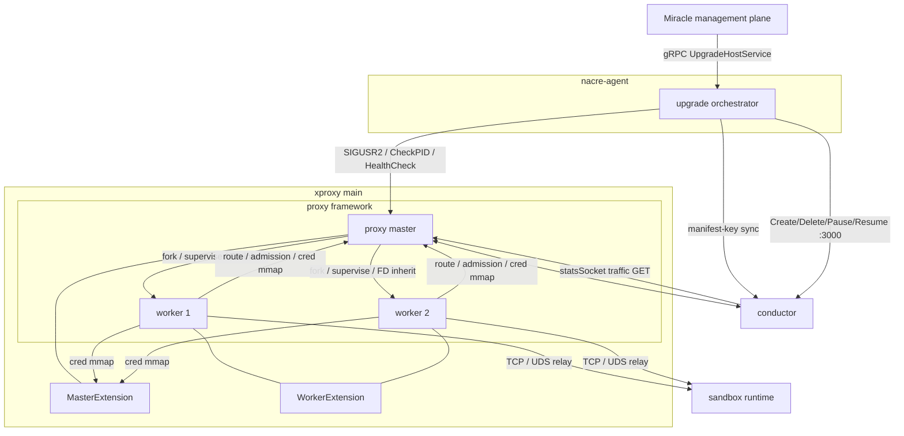
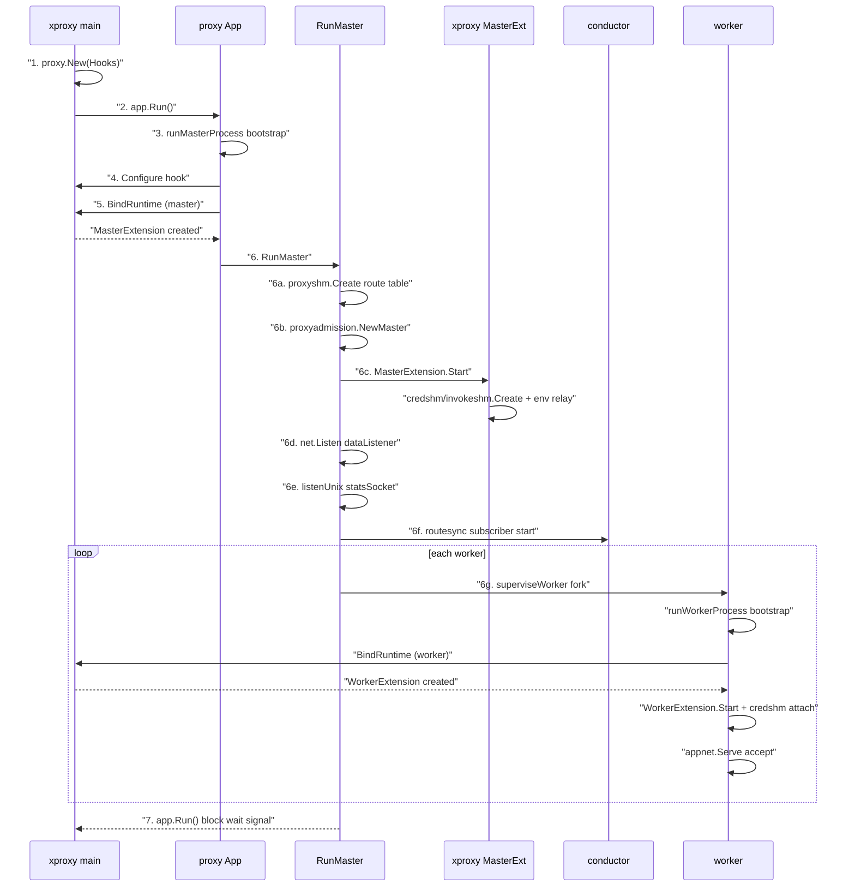
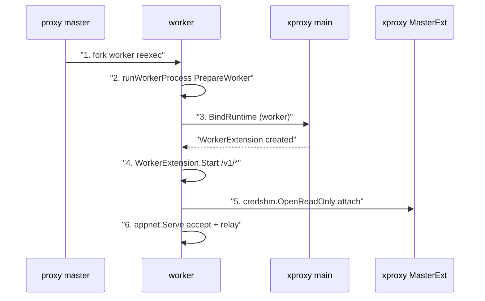

# proxy 热升级方案

> **变更编号**: FE2026050900370-BMS节点组件热升级
> **评审结论**: conductor 不做热升级（冷重启 + nacre-agent 重试兜底），**proxy 做热升级**
> **文档版本**: V3.7（评审修订：P1 互踢震荡修正 + P2 nacre-agent 超时对齐 + M1-M4 中危修复 + L1-L4 建议吸收）
> **代码基线**: orchestrator main `40c7af9`
> **关联文档**: `conductor-no-hotupgrade-with-nacre-retry.md`、`US2026050900110`、`proxy热升级评审问题与解决方案.md`

---

## 1. 方案概述

### 1.1 目标

`node-proxy.service`（node-ctl proxy，数据面 master + worker）在二进制替换时实现热升级：

- 存量沙箱的 WebSocket/exec 长连接**尽力排水不中断**（上限默认 **30min**，可配置；超时 force kill 是兜底而非常态）；
- 新连接正常接入，升级期间服务无空窗；
- **不做缓存交接**——新进程不从老进程缓存中获取快照内容，全部从 conductor routesync resync 重建；
- **升级成功判定 = 新 PID 健康**（不等旧 PID 消失）——旧进程排水是后台收敛，nacre-agent 在预算内即可判成功（V3.7，P2 修复）。

### 1.2 职责划分（评审修订 + 最小框架改动）

| 层 | 职责 | 代码仓 |
|----|------|--------|
| **proxy 框架**（开源仓） | 提供**两个原子能力**（评审修改点 2/3/4 明确要求）：① listener/mmds FD 继承与恢复（启动时支持传入 fd 文件路径、支持监听已有 fd）；② 优雅退出 + 排水（收到 shutdown 信号后优雅退出，**第一步内部取消 routesync subscriber**，存量连接尽力排水，上限默认 30min 可配置）。**另加一个极小 FD 暴露点**（旧进程侧把 listener FD 交给 xproxy，~10-20 行） | `kuasar-sandbox/orchestrator` |
| **xproxy main**（内部仓） | 接收 SIGUSR2 信号 + **编排整个热升级流程**（调用 proxy 的 FD 继承与优雅退出能力） | `kuasar-sandbox-cci` |
| **nacre-agent**（编排器） | **必做适配**（V3.7，P2 修复）：WaitNewPID 语义改为"新 PID 出现且健康"；CheckPID 容忍窗口内双倍进程；MAINPID 切换 | `kuasar-sandbox/nacre-agent` 适配 |

**最小框架改动原则**（V3.7 修订）：
- **RunMaster 结构重构已砍掉**——不需要"编排接口"，xproxy 只需要触发优雅退出 + fork 新进程
- **"停 subscriber"接口砍掉，但"取消 subscriber"动作保留**——V3.6 曾主张靠 conductor evict，实测（`TestRoutesyncEvictionOscillation`：0.31s 互踢 4 回合）证明会持续拉锯直至 drain 结束，且打断新 master Bookmark → ready 超时 → 升级活锁。修正为：**`GracefulShutdown` 第一步内部 cancel subscriber 的 ctx（~3 行，非新增接口）**，回滚时重启 subscriber
- 框架改动 = **评审要求的两个原子能力 + 一个 FD 暴露点**，正常启动路径（非热升级）行为 100% 不变

### 1.3 缓存交接策略（评审修订）

| 状态 | 原方案 V2.0 | V3.0 修订 | 理由 |
|------|-----------|----------|------|
| 路由表 | resync 唯一来源（无快照） | **不变** | 已无快照 |
| admission | quiesce 后 dump + sealed memfd 恢复 | **不做交接**，`NewMaster` 重建 | 评审决定不做框架侧缓存交接 |
| xproxy 凭证表 | Items() 快照 + generation 继承 | **xproxy 仓内部迁移**（框架不改动） | 凭证表全生命周期在 xproxy 仓，迁移由 xproxy main 编排闭环（见 §4.5） |

**框架侧不做缓存交接**——路由表/admission 全部从零重建：
- 路由表 → conductor routesync 全量 resync
- admission → `NewMaster` 重建空 arena

**xproxy 凭证表迁移在 xproxy 仓内部完成**——不需要修改 proxy 框架代码：
- xproxy 的 `masterext.Extension` + `credshm`/`invokeshm` 包拥有凭证表的全部生命周期（Create/Items/Upsert/Close）
- 框架只调 `MasterExtension.Start`，不感知 credshm 的存在
- 迁移流程（Items 导出 → Close 释放 Flock → Create 重建 → Upsert 恢复 → generation 继承）全部在 xproxy 仓闭环

### 1.4 热升级 vs 冷启动

| 维度 | 冷启动（现状） | 热升级（目标） |
|------|--------------|--------------|
| 存量长连接 | **全部断开** | **尽力排水不中断**（上限 30min 可配置） |
| 新连接空窗 | 有（端口 refused ~25ms，恢复 ~50ms） | 无（listener FD 共享 + ready-pipe 交接） |
| 内存状态 | 全量重建 | 路由表/admission 全量重建；**xproxy 凭证表由 xproxy 仓内部迁移**（generation 继承，无重推窗口） |
| 区别 | 连接断 + 状态重建 | **连接不断** + 路由/admission 重建 + 凭证表迁移 |

---

## 2. 组件交互关系

### 2.1 进程/组件全景

```
┌──────────────────────────────────────────────────────────────────────┐
│                           BMS 节点                                    │
│                                                                       │
│  ┌────────────────┐                                                   │
│  │  nacre-agent   │ ① 升级编排：systemctl MainPID → SIGUSR2          │
│  │                │ ② CheckPID/WaitNewPID/HealthCheck                │
│  └───────┬────────┘                                                   │
│          │ SIGUSR2                                                    │
│          ▼                                                            │
│  ┌──────────────────────────────────────────────────────────────┐    │
│  │  xproxy main（node-ctl proxy serve，paths.proxy_executable） │    │
│  │  ┌─────────────────────────────────────────────────────────┐ │    │
│  │  │  proxy 框架（App.Run → RunMaster）                        │ │    │
│  │  │  ├─ master 进程                                          │ │    │
│  │  │  │   ├─ dataListener（TCP）                               │ │    │
│  │  │  │   ├─ mmdsListener（netns TCP）                         │ │    │
│  │  │  │   ├─ statsSocket（UDS）                                │ │    │
│  │  │  │   ├─ routesync subscriber ←── config-socket ────┐      │ │    │
│  │  │  │   ├─ admission arena（memfd）                    │      │ │    │
│  │  │  │   └─ worker 监管（superviseWorker）               │      │ │    │
│  │  │  │                                                  │      │ │    │
│  │  │  ├─ worker 进程（N）                                 │      │ │    │
│  │  │  │   ├─ 继承 listener FD → accept 连接               │      │ │    │
│  │  │  │   ├─ 查路由表（proxyshm mmap 只读）              │      │ │    │
│  │  │  │   ├─ 查凭证表（credshm mmap 只读，仅 xproxy）     │      │ │    │
│  │  │  │   └─ 双向 relay：客户端 ←→ sandbox 后端           │      │ │    │
│  │  │  │                                                  │      │ │    │
│  │  │  └─ MasterExtension.Start（xproxy masterext）        │      │ │    │
│  │  │      ├─ credshm.Create（凭证表，master 唯一写者）     │      │ │    │
│  │  │      ├─ invokeshm.Create（invoke 表）                │      │ │    │
│  │  │      └─ WrapManagement（/nacre/credentials push）    │      │ │    │
│  │  └─────────────────────────────────────────────────────┘      │ │    │
│  └──────────────────────────────────────────────────────────────┘ │    │
│                                          │                        │      │
│          ┌───────────────────────────────┘                        │      │
│          ▼                                                        │      │
│  ┌────────────────┐    ┌────────────────────┐                    │      │
│  │  conductor      │    │  sandbox-runner     │                    │      │
│  │  (node-ctl.svc) │    │  @<runid>.service   │                    │      │
│  │  ├─ SQLite DB   │    │  ├─ sandbox-ctl     │                    │      │
│  │  ├─ config-sock │    │  └─ cloud-hypervisor│                    │      │
│  │  ├─ API :3000   │    └────────────────────┘                    │      │
│  │  └─ node-link   │                                             │      │
│  └────────────────┘                                             │      │
│                                                                  │      │
│  ┌────────────────┐                                             │      │
│  │  nacre-agent   │ ─── gRPC UpgradeHostService ─── 管理面      │      │
│  │  (自身进程)    │ ─── manifest-key sync → conductor UDS ──────┘      │
│  └────────────────┘                                                   │
└──────────────────────────────────────────────────────────────────────┘
```

### 2.2 组件交互关系详表

**交互全景图**：



**交互说明**：
- **P0 升级编排**：nacre-agent → xproxy master（SIGUSR2 信号，systemctl MainPID）
- **P1 路由权威**：proxy master ↔ conductor（config-socket UDS，h2c routesync / barrier）
- **P2 共享内存**：worker → master（proxyshm/admission/credshm mmap，无 IPC）
- **P3 数据面**：worker → sandbox（TCP floatingip:port / UDS relay）

**调用优先级（编号标注，从高到低）**：

| 优先级 | 调用方 | 被调方 | 接口/协议 | 交互内容 |
|--------|--------|--------|---------|-----------|
| **P0** | nacre-agent | xproxy master | SIGUSR2 信号（systemctl MainPID） | 触发热升级（最高优先，信号直达） |
| **P0** | nacre-agent | xproxy master | systemd `ControlGroup` → `cgroup.procs` | CheckPID/WaitNewPID/HealthCheck |
| **P1** | xproxy master | proxy 框架（RunMaster） | 进程内函数调用 | FD 继承、优雅退出、worker drain（编排调框架原子能力） |
| **P1** | proxy master | conductor | config-socket UDS（h2c 双向流） | routesync 注册 + 路由同步 + Wake + route barrier |
| **P2** | conductor | proxy master | statsSocket UDS | traffic GET（inflight/idleSince 汇总） |
| **P2** | proxy worker | proxy master | proxyshm mmap（只读） | 查路由表（内存读，无 IPC） |
| **P2** | proxy worker | proxy master | admission mmap（写自己的行） | inflight 计数（内存读写，无 IPC） |
| **P2** | proxy worker | xproxy MasterExtension | credshm mmap（只读） | 查凭证 token（内存读，无 IPC） |
| **P3** | proxy worker | sandbox 后端 | TCP（floatingip:port）/ UDS（sandbox-ctl --connect） | relay 双向字节流（用户数据面） |
| **P3** | nacre-agent | conductor | config-socket UDS（admin plane） | manifest-key 同步（周期性） |
| **P3** | nacre-agent | conductor | HTTP REST API（:3000） | Create/Delete/Pause/Resume/Export（workqueue 重试） |
| **P3** | nacre-agent | conductor | HTTP REST API（:3000） | GetSandbox/ListSandboxes（轮询） |

> **优先级说明**：P0 = 热升级触发（编排入口，信号直达）；P1 = 框架能力调用 + 路由同步（热升级编排与路由权威）；P2 = 共享内存/聚合查询（无 IPC，内存路径）；P3 = 数据面 + 管理面例行交互。

### 2.3 master 与 worker 的关系

| 维度 | master | worker |
|------|--------|--------|
| 角色 | 管理：路由表写者、admission 分配者、routesync 订阅者、worker 监管 | 服务：accept 连接 + 双向 relay |
| 持有的 listener | dataListener/mmdsListener/statsSocket（创建 bind） | 继承 listener FD（共享 accept） |
| 共享内存访问 | 路由表**写**、admission**分配**、credshm**写** | 路由表**只读**、admission**写自己的行**、credshm**只读** |
| 长连接 | 不持有 | **持有**（客户端 FD + 后端 FD + relay goroutine） |
| 热升级中 | 旧 master fork 新 master + 通知旧 worker drain | 旧 worker drain 存量连接 → 退出；新 worker accept 新连接 |
| 崩溃恢复 | systemd 重启（冷启动） | master `superviseWorker` 自动重启（新 epoch） |

### 2.4 xproxy 与 proxy 框架的关系

| 维度 | proxy 框架（开源仓） | xproxy（内部仓） |
|------|---------------------|-----------------|
| 代码位置 | `orchestrator/internal/proxyapp/` + `app/proxy/` | `kuasar-sandbox-cci/cmd/xproxy/main.go` + `pkg/xproxy/` |
| 职责 | 进程模型、listener 管理、worker fork、路由表、admission、routesync | 凭证表（credshm）、invoke 表（invokeshm）、ingress 拦截（/v1/exec /v1/files /v1/invoke）、TLS 解密 |
| 注册方式 | - | `proxy.New(proxy.Hooks{Configure, BindRuntime})` |
| 运行时关系 | 框架是"宿主"，xproxy 是"插件" | xproxy 通过 Hooks 注册 MasterExtension + WorkerExtension |
| 调用优先级 | 框架先启动（RunMaster）→ 调 `MasterExtension.Start` → 再 fork worker → worker 调 `WorkerExtension.Start` | xproxy 的 Start 在框架启动 listener/routesync/worker 之前执行 |
| 热升级中的角色 | **提供原子能力**：FD 继承 + 优雅退出 | **编排**：接收 SIGUSR2 + 调用框架能力 |

**调用优先级**（master 启动顺序）：



**调用优先级**（worker 启动顺序）：



---

## 3. proxy 框架需提供的原子能力（最小改动）

> **框架改动 = 评审要求的两个原子能力 + 一个 FD 暴露点**。不做 RunMaster 结构重构、不做独立停 subscriber 接口。

### 3.1 能力一：listener/mmds FD 继承与恢复（评审修改点 2）

**框架需支持**（双向）：
1. **新进程侧（收 FD）**：启动时传入 fd 的文件路径，检测热升级标记后跳过 `net.Listen`，用 `net.FileListener(fd)` 恢复 listener
2. **旧进程侧（给 FD）**：把已创建的 listener FD 暴露给 xproxy，供 fork 新进程时通过 ExtraFiles 传递

**具体改动**：

| 改动 | 位置 | 说明 |
|------|------|------|
| `RestoreListenerFromFD(fd int)`（新进程侧） | `internal/proxyapp/hotupgrade.go`（新增） | 检测 `KUASAR_PROXY_HOT_UPGRADE=1`，复用现有 `listenerFromFD`（`worker.go:306`，worker 已生产验证） |
| **`CaptureListenerFDs() (dataFD, mmdsFD *os.File)`**（旧进程侧，FD 暴露点） | `internal/proxyapp/master.go`（新增 ~10-20 行） | RunMaster 创建 listener 后，把 dataListener/mmdsListener 的 FD 存到可访问处；xproxy 调用此函数取出供 fork |
| mmdsListener FD 恢复 | 同上 | mmdsListener 在 netns 中创建，FD 继承后 netns 归属由内核保证（与 worker 机制相同） |
| statsSocket **不继承 FD** | - | 聚合状态服务，共享 accept 会分裂查询；新 master 重新 bind 新路径 |

> **关键**：`CaptureListenerFDs` 是唯一的"旧进程侧"改动——RunMaster 里 listener 创建后把 FD 记到一个注入的 recorder（或包级 hook），**正常启动不调用，行为不变**。xproxy 通过 Hooks 传入 recorder，热升级时取 FD。

**不继承 FD 的资源**（冷启动重建）：
- 路由表 SHM：`proxyshm.Create` 重建空表（不继承老 mmap）
- admission arena：`proxyadmission.NewMaster` 重建空 arena（不继承 memfd）
- statsSocket：重新 `listenUnix` bind
- metricsListener：老 master 关闭 + 新 master 退避重试 bind

### 3.2 能力二：优雅退出 + 排水（评审修改点 3/4）

**框架需支持**：
1. **收到 shutdown 信号后优雅退出**：不是立即关闭，而是进入 drain 模式
2. **存量长连接尽力排水**：旧 worker 标记 `isDraining` → 停止 accept → 继续服务存量连接 → 排空后退出
3. **可配置上限**：drain 超时默认 **30min**（评审修改点 4），超时 force kill

**优雅退出拆两段（V3.7，M3 修复）**：

| 段 | 触发时 | 动作 |
|----|--------|------|
| **前段**（`GracefulShutdown` 触发时） | 收到 shutdown 信号 | ① **第一步内部取消 routesync subscriber 的 ctx**（~3 行，非新增接口；P1 修复，防互踢震荡）；② 挂起 worker 监管；③ 取 FD + 导出凭证表；④ 关闭 metrics listener。**不通知停 accept**——fork 至 ready 期间旧 worker 继续 accept，无 backlog 停滞 |
| **后段**（`DrainWorkers` 调用时） | 新 master ready 之后 | 通知旧 worker 停 accept（`isDraining`）→ 等待 inflight 归零 → 超时 force kill |

**优雅退出天然包含的能力**（无需额外编排接口）：
- **第一步取消 subscriber**：cancel routesync subscriber 的 ctx（V3.7 P1 修复）——此后旧 master 路由视图真正冻结，与 drain 语义一致；对纯框架场景（systemd stop → 优雅退出）同样正确
- **挂起 worker 监管**：drain 期间 superviseWorker 的 ctx 取消 → 停止"崩溃自动重启"
- **通知 worker drain**：通过现有 wake pipe / stats socket 通道（后段）
- **等待 inflight 归零**：复用 proxystats per-sandbox inflight 跟踪

**具体改动**：

| 改动 | 位置 | 说明 |
|------|------|------|
| `GracefulShutdown(ctx)`（前段） | `internal/proxyapp/master.go`（新增方法） | 第一步 cancel subscriber + 挂起 worker 监管 + 关 metrics（**不通知停 accept**） |
| `DrainWorkers(ctx, drainTimeout)`（后段） | `internal/proxyapp/master.go`（新增方法） | 通知 worker drain → 等待 inflight 归零 → 超时 force kill |
| `NotifyWorkersToDrain()` | `internal/proxyapp/master.go`（新增） | 通过 wake pipe 或 stats socket 通知 worker |
| `WaitWorkerDrain(timeout)` | `internal/proxyapp/master.go`（新增） | 等 proxystats inflight 归零（复用现有 per-sandbox inflight 跟踪） |
| `RestartRoutesyncSubscriber()`（回滚用） | `internal/proxyapp/master.go`（新增） | fork 失败/ready 超时后重启 subscriber（superviseWorker 式重拉） |
| worker 端 `isDraining` 标记 | `internal/proxyapp/process.go`（新增） | 关闭自己的 listener FD 副本停 accept，继续 relay 存量 |
| drain 超时配置 | `config.Proxy` 新增字段 `drain_timeout` | 默认 30min（需与 nacre-agent 编排预算对齐，见 P2） |

**drain 完成判定**：复用 `proxystats` per-sandbox inflight（parking/egress 归零），无需新建连接跟踪。

> **V3.6 错误修正（P1）**：V3.6 曾主张"砍掉停 subscriber，靠 conductor evict"。实测（`TestRoutesyncEvictionOscillation`：真实双 master，0.31s 内 registered=4/deregistered=4）证明：subscriber 重连退避初期几乎为零（`subscribe.go:73-84`，200ms 起），互踢是持续拉锯；且 drain 30min 意味着震荡窗口 = 整个排水期；更致命的是新 master 的 Bookmark 被反复打断 → ready 超时 → 升级活锁。**修正为 GracefulShutdown 第一步内部 cancel subscriber（非新增接口）**。

---

## 4. xproxy main 的编排流程

### 4.1 SIGUSR2 接收

xproxy main 在 `app.Run()` 之前注册 SIGUSR2 handler（goroutine 监听信号通道），信号到达后启动编排流程。

**编排不需要 RunMaster 结构重构**：xproxy 通过 Hooks 注入的 FD recorder 拿到 listener FD（§3.1），触发框架优雅退出（§3.2），fork 新进程由 xproxy 自己 exec——**不需要框架暴露编排接口**。

### 4.2 编排时序

```mermaid
sequenceDiagram
    participant NAC as nacre-agent
    participant XM as xproxy old
    participant XN as xproxy new
    participant OW as old worker
    participant NW as new worker
    participant COND as conductor
    participant SD as systemd

    NAC->>XM: "replace binary + SIGUSR2"
    XM->>XM: "idempotency check"
    XM->>XM: "GracefulShutdown 前段: cancel subscriber + 挂监管 + 取 FD + 导出凭证 + 关 metrics"
    XM->>XN: "fork exec disk binary (FD: data/mmds + ready-pipe)"
    activate XN
    XN->>XN: "restore listener from FD"
    XN->>XN: "proxyshm.Create empty table"
    XN->>XN: "NewMaster empty arena"
    XN->>XN: "credshm restore + gen inherit"
    XN->>XN: "bind statsSocket new path"
    XN->>COND: "register routesync"
    COND-->>XN: "Hello, Upsert, Bookmark full resync"
    XN->>NW: "fork new worker (new binary)"
    activate NW
    NW-->>XN: "worker ready"
    XN-->>XM: "ready (ready-pipe, 30s timeout)"
    XM->>XM: "GracefulShutdown 后段: DrainWorkers"
    XM->>OW: "notify drain (stop accept)"
    activate OW
    Note over OW: serve existing long connections
    OW-->>XM: "drain done (inflight zero or 30min timeout)"
    deactivate OW
    XM->>XM: "credshm.Close release Flock"
    XM->>SD: "sd_notify MAINPID new pid"
    deactivate XM
    XN->>SD: "sd_notify READY"
    deactivate NW
    deactivate XN
```

**关键时序说明**（V3.7 版）：
1. nacre-agent 替换磁盘二进制 → 向老 master 发 SIGUSR2
2. xproxy main（SIGUSR2 handler）触发 `GracefulShutdown` **前段**：
   - **第一步内部 cancel routesync subscriber 的 ctx**（P1 修复，防互踢震荡；非新增接口）
   - 挂起 worker 监管
   - `CaptureListenerFDs()` 取 data/mmds FD
   - 导出凭证表（sealed memfd 传递，M1 修复）
   - 关闭 metrics listener
   - **不通知停 accept**（M3 修复——fork 至 ready 期间旧 worker 继续 accept，无 backlog 停滞）
3. xproxy fork 新 master（exec 磁盘新二进制，ExtraFiles 传 data/mmds FD + ready-pipe）
4. 新 master 启动：检测热升级标记 → `RestoreListenerFromFD` 恢复 listener → 重建路由表/admission → 恢复凭证表（generation 继承）→ bind statsSocket
5. 新 master 注册 routesync → 全量 resync（Bookmark **单次稳定完成**——旧 subscriber 已取消，无互踢）
6. 新 master fork 新 worker → worker ready → 新 master 发 ready（30s 超时）
7. xproxy 触发 `GracefulShutdown` **后段**（DrainWorkers）→ 老 worker 停 accept + 服务存量长连接 → drain 完成（或 30min 超时）
8. 老 master 释放 credshm Flock → sd_notify MAINPID → 退出；新 master sd_notify READY

**成功判定（P2 修复）**：nacre-agent 在**新 PID 出现且健康**（HealthCheck 打新 master）即判成功，**不等旧 PID 消失**——旧进程排水是后台收敛。CheckPID 需容忍升级窗口内双倍进程（新旧并存），MAINPID 随 sd_notify 切换。

### 4.3 不做缓存交接的实际行为

| 状态 | 旧进程 | 新进程 | 恢复方式 | 窗口 |
|------|--------|--------|---------|------|
| 路由表 | 旧 mmap（**冻结**，GracefulShutdown 第一步取消 subscriber 后不再写） | `Create` 重建空表 → routesync resync | conductor 全量 resync | resync 完成（~几十 ms）前新请求 404 → 503 |
| admission | 旧 arena（冻结） | `NewMaster` 重建空 arena | 路由 resync 后通过路由条目重新初始化 | **排水期内为分域计数**（M2 修订）：存量连接记旧 arena、新连接记新 arena，合并 inflight 可达配置限额 **2×**，需评审确认该降级可接受 |
| xproxy 凭证表 | 旧 credshm（冻结） | `Create` 重建 → 快照 `Upsert` 恢复 → generation 继承 | **xproxy 仓内部迁移**（框架不感知），无重推窗口 |
| **存量长连接** | 旧 worker 继续 relay | 新 worker accept 新连接 | **不中断**（FD 继承 listener + 旧 worker drain） | drain 完成前不中断 |

### 4.4 失败回滚

| 失败场景 | 处理 |
|---------|------|
| fork 失败 / 新 master 启动失败 | xproxy kill 新进程 + **恢复优雅退出**（取消 DrainWorkers、恢复 worker 监管、**重启 routesync subscriber**、重开 metrics）——subscriber 重启为 `RestartRoutesyncSubscriber`（P1 修复） |
| 新 master ready 超时（30s） | 同上 |
| 旧 worker drain 超时（30min） | 旧 master force kill 旧 worker（存量连接断，极端场景）；新 master 已接管 |
| systemd stop 落在升级中 | cgroup 全杀 = 等效冷停（可接受，文档化） |
| 凭证表迁移失败（Create/恢复失败） | xproxy F4 降级：creds=nil，push endpoint 503，/v1/* 降级为 no-token dialing（现有设计，`masterext/ext.go:69-73`） |

### 4.5 xproxy 凭证表迁移细节（xproxy 仓内部闭环，框架不改动）

**核心结论**：凭证表的全部生命周期（Create/Items/Upsert/Close/generation）都在 xproxy 仓的 `masterext.Extension` + `credshm`/`invokeshm` 包里，proxy 框架不感知 credshm 的存在（只调 `MasterExtension.Start`）。迁移全部在 xproxy 仓内部完成，**不需要修改 proxy 框架代码**。

#### 4.5.1 凭证表全生命周期在 xproxy 仓

| 操作 | 位置 | 仓库 |
|------|------|------|
| `credshm.Create(path)` | `masterext/ext.go:67` | xproxy 仓 |
| `credshm.Writer.Items()` | `credshm/writer.go:105` | xproxy 仓 |
| `credshm.Writer.Upsert()` | `credshm/writer.go:122` | xproxy 仓 |
| `credshm.Writer.Close()`（释放 Flock） | `credshm/writer.go:64` | xproxy 仓 |
| `credshm.Reader.OpenReadOnly()`（worker 读） | `credshm/reader.go:29` | xproxy 仓 |
| 环境变量 `XPROXY_CREDS_SHM` 传递 | `masterext/ext.go:78` | xproxy 仓 |
| `invokeshm`（同构） | `masterext/ext.go:84-96` + `invokeshm/` | xproxy 仓 |

#### 4.5.2 迁移时序（全在 xproxy 仓内闭环）

```
旧 master SIGUSR2 handler（xproxy main 接收）:
  1. e.creds.Items() → 导出全部 (sid, token) → **写入 sealed memfd**（M1 修复，不落盘；fork 时本来就要 ExtraFiles 传 FD，顺手传 memfd FD）
  2. e.creds.Close() → 释放 Flock（xproxy 仓内部）
  3. → 触发框架 fork 新 master（调用框架原子能力，ExtraFiles 含凭证 memfd FD）

新 master MasterExtension.Start（框架调用，xproxy 实现）:
  4. 检测热升级标记 → 走恢复路径（非冷启动建空表路径）
  5. credshm.Create() 重建空表（Flock 已释放，不再 ErrLocked）
  6. 从继承的 memfd FD 读取快照 → 逐条 Upsert 恢复
  7. generation 继承（不重置为 0，避免触发 nacre-agent 全量重推）
  8. invokeshm 同构迁移
```

**框架的角色**：只在步骤 3（fork）和步骤 4（调 Start）时参与，**框架不知道凭证表的存在**，只是正常的 fork + 调 `MasterExtension.Start`。

> **V3.6 错误修正（M1）**：V3.6 写"导出到临时文件"，但 (sid, token) 是凭证明文，且进程被 kill 时临时文件可能残留——违反验收 13"磁盘任意时刻不存在含凭证明文的快照文件"，是问题 5 同款错误复发。**修正为 sealed memfd 传递，不落盘**。

#### 4.5.3 Flock 时序与 Reader 无锁

- Flock 只是**写者锁**，Reader（worker）不需要锁（`OpenReadOnly` 直接 mmap，`reader.go:29`）
- 旧 master 仍持有 Flock 时，新 worker 可作为 Reader 只读 attach 旧文件 → 正常查 token 处理新请求
- 锁只在"新 master 升级为写者"（Create）时需要等待——旧 master Close 释放后新 master 才能 Create
- **与 conductor SQLite 的本质区别**：SQLite 读写都要锁（新进程拿不到锁 → 请求失败）；credshm 读不锁写才锁（新进程拿不到写锁仍可读 → 请求正常）

#### 4.5.4 xproxy MasterExtension 进程内状态

`masterext.Extension` 结构体里的 `creds *credshm.Writer` 和 `invokeShm *invokeshm.Writer` 是 master 进程内存指针——新 master 的 `Extension` 是**全新实例**（`masterext.New(log)` 创建），不继承旧 master 的进程内状态。迁移靠的是：
- 旧 master 的 `Writer.Items()` 把**数据**导出到 **sealed memfd**（进程间通过 FD 传递，M1 修复）
- 新 master 的 `Writer.Create + Upsert` 从 memfd 读数据恢复到新表
- 不是"传指针"，是"传数据"

---

## 5. 降级清单

| 降级 | 触发窗口 | 影响 |
|------|---------|------|
| 新请求 503/502（路由 resync 完成前） | fork 至 Bookmark | 短暂（几十 ms），SDK 重试覆盖；**凭证表已迁移，无 502 窗口** |
| parked 请求等 park_timeout 超时 | quiesce 至旧 worker 退出 | park 本就有超时语义 |
| MMDS 查询 503 | 同上 | MMDS 仅 envd 初始化使用 |
| conductor pause/delete 暂不传播 | 同上 | 视图冻结是 drain 语义的一部分 |
| 在途 Create（barrier 未 ACK）503 | quiesce 至新 Bookmark | SDK 重试覆盖 |
| metrics 短暂缺失 | 旧 master 关 listener 至新 master bind | 观测面降级 |
| traffic GET 偶发失败 | stats 切换瞬间 | 客户端重试 |
| **超过 drain 上限（30min 可配置）的长会话断开** | 旧 worker force kill | **"零中断"承诺 = 尽力排水 + 上限可配置** |

---

## 6. 新增代码点汇总

### 6.1 proxy 框架（开源仓 `kuasar-sandbox/orchestrator`）——最小改动

| 代码点 | 位置 | 说明 |
|--------|------|------|
| **`CaptureListenerFDs`（FD 暴露点）** | `internal/proxyapp/master.go`（新增 ~10-20 行） | RunMaster 创建 listener 后把 data/mmds FD 存到注入的 recorder；xproxy 通过 Hooks 传入 recorder，热升级时取 FD |
| `RestoreListenerFromFD`（新进程侧） | `internal/proxyapp/hotupgrade.go`（新增） | 热升级模式 FD 恢复（复用 `listenerFromFD`） |
| `GracefulShutdown`（前段） | `internal/proxyapp/master.go`（新增） | **第一步内部 cancel routesync subscriber 的 ctx（~3 行，非新增接口）** + 挂起 worker 监管 + 关 metrics（V3.7 P1） |
| `DrainWorkers` + `NotifyWorkersToDrain` + `WaitWorkerDrain`（后段） | `internal/proxyapp/master.go`（新增） | 通知 worker drain → 等 inflight 归零 → 超时 force kill（V3.7 M3：ready 后才调用） |
| `RestartRoutesyncSubscriber()`（回滚用） | `internal/proxyapp/master.go`（新增） | fork 失败/ready 超时后重启 subscriber（P1 修复） |
| worker 端 `isDraining` | `internal/proxyapp/process.go`（新增） | 关 listener FD 副本停 accept + 继续 relay |
| drain 超时配置 | `config.Proxy` 新增 `drain_timeout` | 默认 30min（需与 nacre-agent 编排预算对齐，P2） |

> **砍掉**：RunMaster 结构重构、bind 先行。**保留（作为动作非接口）**：GracefulShutdown 第一步内部取消 subscriber。

### 6.2 xproxy（内部仓 `kuasar-sandbox-cci`）

| 代码点 | 位置 | 说明 |
|--------|------|------|
| SIGUSR2 handler + 编排 | `cmd/xproxy/main.go`（新增） | 信号接收 + 触发优雅退出前段 + 取 FD + fork + ready + 触发后段 drain |
| `ForkNewMaster` + ready-pipe | `cmd/xproxy/main.go` 或 `pkg/xproxy/hotupgrade/`（新增） | exec 磁盘新二进制 + ExtraFiles（含凭证 memfd FD）+ 超时 |
| 热升级 bootstrap | `pkg/xproxy/hotupgrade/`（新增） | sealed memfd 传递 gen + 路径 + ready-pipe；**身份校验语义 = 同 component + `ConfigSchemaVersion` 兼容**（M4 修复，复用现有字段；worker 路径的同文件校验保持不变） |
| 凭证表迁移（credshm/invokeshm） | `pkg/xproxy/masterext/ext.go`（新增热升级分支） | Items 导出 → **sealed memfd**（M1）→ Close 释放 Flock → Create 重建 → 从 memfd Upsert 恢复 → generation 继承（框架不感知） |

### 6.3 不需要的代码（V2.0/V3.0 删除项）

| V2.0 代码 | V3.7 状态 | 理由 |
|-----------|----------|------|
| 路由表 dump/restore | **删除** | 不做框架侧缓存交接 |
| admission dump/restore + `AttachMaster(fd)` | **删除** | 不做框架侧缓存交接，`NewMaster` 重建 |
| credshm/invokeshm 框架侧代码 | **不需要** | 凭证表迁移在 xproxy 仓内部闭环，框架不感知 credshm |
| SHM 分代模型 | **简化** | 不继承老 mmap，新 master `Create` 重建（但需分代避免老 master 退出误删） |
| **RunMaster 结构重构** | **删除** | 不需要编排接口，xproxy 只触发优雅退出 + 取 FD |
| **"停 subscriber"接口** | **删除** | 取消 subscriber 作为 GracefulShutdown 第一步内部动作（~3 行），不暴露接口（V3.7 P1 修正） |
| **bind 先行** | **删除** | 分代设计下非必要；但"并发冷启动打断在役实例"为现存隐患，建议顺手修（L1） |

---

## 7. 代码量与工作量

### 7.1 代码量估算

| 模块 | 估算行数 | 说明 |
|------|---------|------|
| proxy 框架：FD 恢复（RestoreListenerFromFD） | 60-100 | 复用 `listenerFromFD`，编排分支 |
| proxy 框架：**CaptureListenerFDs（FD 暴露点）** | 10-20 | 注入 recorder，RunMaster 创建 listener 后存 FD |
| proxy 框架：优雅退出（前段 GracefulShutdown + 后段 DrainWorkers） | 160-240 | **含第一步 cancel subscriber（~3 行）+ 挂监管 + drain + inflight 判定 + RestartRoutesyncSubscriber** |
| xproxy：SIGUSR2 + 编排 + fork | 250-400 | 信号 handler + 触发优雅退出前/后段 + 取 FD + ForkNewMaster + ready-pipe + 回滚 |
| xproxy：热升级 bootstrap | 150-250 | sealed memfd + gen + 路径 + **身份校验（component + ConfigSchemaVersion）** |
| **nacre-agent：编排适配（P2 必做）** | 100-200 | WaitNewPID 改为"新 PID 健康"、CheckPID 容忍双倍进程、MAINPID 切换 |
| 测试 | 500-700 | docker 集成 harness + 升级流程回归 + **震荡回归测试** |
| **合计（不含测试）** | **730-1210**（中位约 970） | |
| **合计（含测试）** | **1230-1910** | |

### 7.2 工作量

| 维度 | 估算 |
|------|------|
| 开发（含自测） | **4-5 人天** |
| 测试/联调 | 1.5-2 人天 |
| **合计** | **5.5-7 人天** |

> V3.6 估 4.5-6.5 人天；V3.7 修复 P1（subscriber 取消/重启 +0.2）、P2（nacre-agent 适配必做 +0.5-1）、M1-M4（memfd/bootstrap/两段式 +0.3），净增约 1 人天（评审 L4 确认）。

### 7.3 实现顺序

1. **proxy 框架：优雅退出 + 排水**（原子能力一，含第一步 cancel subscriber + 两段式，独立 PR）
2. **proxy 框架：FD 继承 + CaptureListenerFDs**（原子能力二 + FD 暴露点，独立 PR）
3. **xproxy：SIGUSR2 + 编排 + fork + ready-pipe + 凭证表迁移（sealed memfd）**
4. **xproxy：热升级 bootstrap**（含身份校验语义）
5. **nacre-agent：编排适配**（P2 必做：WaitNewPID 语义、CheckPID 容忍、MAINPID 切换）
6. **集成测试**（连续升级 gen 0→1→2、回滚、drain、fork 二进制验证、**双 master 震荡回归**）

---

## 8. 风险与缓解

| 风险 | 可能性 | 影响 | 缓解 |
|------|--------|------|------|
| 优雅退出"取消"不可用（回滚时无法恢复） | 中 | 高 | GracefulShutdown 拆前段/后段：前段（cancel subscriber + 挂监管）可逆，后段（DrainWorkers）才不可逆；回滚只恢复前段 + RestartRoutesyncSubscriber |
| ~~老 subscriber 靠 evict → 互踢震荡~~（V3.7 已消除） | - | - | GracefulShutdown 第一步内部 cancel subscriber；震荡回归测试入仓（`TestRoutesyncEvictionOscillation`） |
| nacre-agent 超时预算（120s） vs drain（30min）冲突 | 中 | 高 | **成功判定 = 新 PID 健康**，不等旧 PID 消失；nacre-agent 适配必做（P2） |
| admission 排水期分域计数（合并可超限 2×） | 中 | 中 | 如实文档化（M2）；需评审确认该降级可接受 |
| 不做缓存交接的 502/503 窗口 | 中 | 中 | resync 几十 ms~几秒；SDK 重试覆盖；存量连接不中断 |
| drain 超时断存量连接 | 低 | 高 | 30min 上限可配置；超时是兜底非常态 |
| netns FD 传递 | 中 | 高 | mmdsListener 集成测试覆盖 |
| statsSocket 分代 / 删除竞态 | 中 | 中 | 分代路径 + 持有者自删 + 冷启动清扫 + **稳定符号链接（L2，捡回）** |
| 并发冷启动打断在役实例（L1 现存隐患） | 中 | 中 | 建议顺手修（bind-first 或实例互斥），与热升级无关 |

---

## 9. 验收标准

- [ ] 热升级期间存量长连接**尽力排水不中断**，超过可配置上限（默认 **30min**）的会话允许断开
- [ ] 热升级期间新连接正常接入，服务无空窗（listener FD 共享 + ready-pipe 交接）
- [ ] 升级后新 master 二进制为磁盘新版本（`/proc/<pid>/exe` 指向新文件），worker 链路同为新版本
- [ ] 路由表/admission 全部从零重建（不做框架侧缓存交接），路由表经 conductor routesync 全量 resync 恢复
- [ ] xproxy 凭证表经 xproxy 仓内部迁移恢复（Items 导出 → Create 重建 → Upsert 恢复 → generation 继承），**无 nacre-agent 重推窗口**
- [ ] proxy 框架代码**不需要感知凭证表迁移**（迁移在 xproxy 仓内部闭环）
- [ ] SIGUSR2 由 **xproxy main** 接收并编排整个热升级流程
- [ ] proxy 框架提供 FD 继承与优雅退出两个原子能力，xproxy 调用
- [ ] 连续两次热升级后磁盘无残留分代文件
- [ ] **升级全程 conductor 侧租约不出现震荡**（实测：双 master 并存窗口内 registered/deregistered 各 ≤ 1 次，V3.7 P1）
- [ ] **新 master ready 不依赖旧 subscriber 退出**（取消语义生效，Bookmark 单次完成，V3.7 P1）
- [ ] **nacre-agent 在新 PID 健康后即判定成功**，不等旧 PID 消失；单组件超时预算 ≥ drain 上限或明确分离（V3.7 P2）
- [ ] 升级失败回滚后，优雅退出取消 + 恢复 worker 监管 + 重启 subscriber + 重开 metrics，数据面持续可用
- [ ] **凭证表迁移全程无磁盘明文文件**（含失败/被 kill 场景无残留，V3.7 M1 sealed memfd）
- [ ] **GracefulShutdown 前段不通知停 accept**：fork 至 ready 期间新连接可正常完成握手（无 backlog 停滞，V3.7 M3）
- [ ] **排水期内 admission 分域计数的降级语义已获评审确认**（合并可超限 2×，V3.7 M2）
- [ ] 支持连续热升级（新 master 注册 SIGUSR2）
- [ ] 磁盘任意时刻不存在含凭证明文的快照文件

---

## 附录 A. 评审问题记录（V2.0 遗留 + V3.0/V3.6/V3.7 修订）

| # | V2.0 问题 | V3.7 处理 |
|---|----------|----------|
| 1 | SHM 同路径 O_TRUNC 清空老视图 | 新 master Create 重建（不继承老 mmap）；需分代避免老 master 退出误删 |
| 2 | statsSocket FD 继承致查询分裂 | 不继承 FD，新 master 重新 bind |
| 3 | routesync 同 id 注册互踢 | **V3.7（P1 修正）**：GracefulShutdown 第一步内部 cancel subscriber（~3 行，非新增接口）；回滚时 RestartRoutesyncSubscriber。V3.6 曾主张靠 evict，实测 `TestRoutesyncEvictionOscillation` 0.31s 互踢 4 回合、持续拉锯至 drain 结束、打断新 master Bookmark → 活锁，故修正 |
| 4 | metrics_listen 端口冲突 | 老 master fork 后关闭；新 master 退避重试 |
| 5 | 路由快照凭证明文落盘 | **不做缓存交接，无快照** |
| 6 | admission dump 时点错误 | **不做缓存交接，NewMaster 重建**；排水期分域计数降级已文档化（M2） |
| 7 | drain 期间 superviseWorker 重启 | 优雅退出（GracefulShutdown）挂起监管 |
| 8 | SIGUSR2 无幂等 | in-progress 拒绝 |
| 9 | 路径覆盖破坏 digest | bootstrap 独立字段 |
| 10 | fork 目标旧二进制 | exec 磁盘路径 |
| 11 | RunMaster 黑盒 | 砍掉结构重构，改最小 FD 暴露点（CaptureListenerFDs）+ xproxy 触发优雅退出 |
| 12 | 冻结配置未文档化 | 写入运维手册 |
| **V3.0 新增** | 缓存交接不做 | 全部从零重建（路由 resync + admission 重建 + 凭证迁移） |
| **V3.0 新增** | drain 上限 10min → 30min | 需求评审修订；V3.7 P2 与 nacre-agent 预算对齐（成功判定 = 新 PID 健康） |
| **V3.0 新增** | SIGUSR2 由 xproxy main 接收 | 编排由 xproxy 负责，框架只提供原子能力 |
| **V3.6 新增** | 框架最小改动 | 砍 RunMaster 重构 + 停 subscriber 接口；框架 = 评审要求的两原子能力 + FD 暴露点 |
| **V3.7 新增** | P1 互踢震荡 | GracefulShutdown 第一步内部 cancel subscriber + 回滚重启 |
| **V3.7 新增** | P2 超时预算冲突 | 成功判定 = 新 PID 健康；nacre-agent 适配改必做 |
| **V3.7 新增** | M1 凭证落盘 | 改 sealed memfd 传递 |
| **V3.7 新增** | M2 admission 降级低估 | 如实写"排水期分域计数，合并可超限 2×"，需评审确认 |
| **V3.7 新增** | M3 停 accept 时机矛盾 | GracefulShutdown 拆前段/后段，drain 在 ready 后 |
| **V3.7 新增** | M4 bootstrap 校验语义 | 明确"同 component + ConfigSchemaVersion 兼容" |
| **V3.7 新增** | L1 并发启动隐患 | 顺手修（bind-first / 实例互斥），与热升级无关 |
| **V3.7 新增** | L2 稳定符号链接 | 捡回（proxy-stats.sock -> .g<gen>） |
